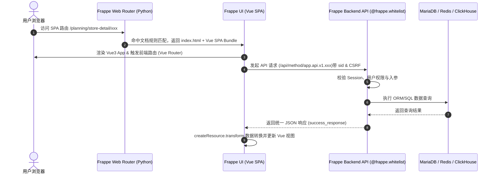

# Frappe UI 与 Frappe Backend 结合逻辑指南

本 Skill 沉淀了 `frappe-ui` 与 Frappe 后端框架结合的核心架构、路由转发、认证机制、通信协议与开发规范。

---

## 1. 整体结合架构图



---

## 2. 核心结合逻辑

### 2.1 SPA 页面路由与托管 (`hooks.py`)
在 Frappe 应用的 `hooks.py` 中配置 `website_route_rules`，将前端 SPA 的入口路径转发给 Frappe 托管网页：

```python
# product_sales_planning/hooks.py
website_route_rules = [
    {"from_route": "/planning/<path:app_path>", "to_route": "planning"},
    {"from_route": "/planning", "to_route": "planning"},
]
```
- 当用户访问 `/planning/store-detail/...` 时，Frappe 路由引擎拦截并交由 `www/planning.py` / `www/planning.html` 处理。
- Vite 构建产物输出至 `product_sales_planning/public/planning/`，静态资源由 Frappe/Nginx 统筹托管。

---

### 2.2 前后端 API 通信机制 (`createResource` & `@frappe.whitelist`)

#### 后端定义 (@frappe.whitelist)
所有允许前端调用的 Python 方法必须添加 `@frappe.whitelist()` 装饰器：

```python
# product_sales_planning/api/v1/planning_rules.py
import frappe
from product_sales_planning.utils.response_utils import success_response, error_response

@frappe.whitelist()
def get_rule_config(config_name=None):
    user = frappe.session.user
    if not user or user == "Guest":
        return error_response("未登录")
    ...
    return success_response(data=config_data, message="获取配置成功")
```

#### 前端调用 (createResource)
前端使用 `frappe-ui` 提供的 `createResource` 状态机接管数据请求：

```javascript
// frontend/src/utils/planningRuleEngine.js
import { createResource } from 'frappe-ui'

this.ruleConfigResource = createResource({
  url: 'product_sales_planning.api.v1.planning_rules.get_rule_config',
  makeParams: () => ({
    config_name: this._configName || null
  }),
  auto: false,
  cache: (params) => `rule-config-${params.config_name || 'default'}`,
  transform: (response) => {
    // 自动清洗与包装解构
    const actualData = response?.message || response
    if (actualData?.status === 'success' && actualData.data?.thresholds) {
      return actualData.data.thresholds
    }
    return null
  },
  onSuccess: (data) => { ... },
  onError: (error) => { ... }
})
```

---

### 2.3 身份认证与安全 (Session, CSRF & 权限)

1. **Session (`sid` Cookie)**:
   - 浏览器自动在请求头带上 `sid` cookie。
   - 后端在 `frappe.session.user` 中自动还原当前登录用户身份。
2. **CSRF 防护 (`X-Frappe-CSRF-Token`)**:
   - `frappe-ui` 底层请求拦截器会自动读取 `window.frappe.boot.csrf_token` 或系统 Cookie，并在 HTTP Header 中注入 `X-Frappe-CSRF-Token`。
3. **数据权限勾连**:
   - 在 API 内部调用 `product_sales_planning.permissions.get_user_visible_stores(user)` 进行行级/店铺级权限过滤。

---

### 2.4 本地开发与 Vite 代理 (`vite.config.js`)

在本地开发阶段（`npm run dev`），Vite 运行在前端独立端口，通过代理把接口请求转给 Frappe Bench 后端：

```javascript
// vite.config.js
export default defineConfig({
  server: {
    proxy: {
      '^/(app|api|assets|files)': {
        target: 'http://127.0.0.1:8000', // 指向 Frappe Backend Bench 端口
        ws: true,
        router: (req) => {
          const siteName = req.headers.host.split(':')[0]
          return `http://${siteName}:8000`
        }
      }
    }
  }
})
```

---

## 3. 开发规范与避坑指南

1. **零值 (`0`) 与空值 (`null`/`''`) 区分**:
   - 传输计划量/数值数据时，切忌把 `0` 误转为空字符串 `''`，否则会导致 `createResource` 或计算规则把 `0` 误判为未填。
2. **跨域与 CSRF Token**:
   - 前端独立的测试环境调用 API 时，必须确认为登录状态且携带有效 CSRF Token，否则 Frappe 会抛出 `403 Invalid CSRF Token`。
3. **`createResource` 的 `auto` 与 `cache` 属性**:
   - 需要手动触发的接口设为 `auto: false`。
   - 使用动态 `cache` Key 避免不同参数的数据相互污染。
