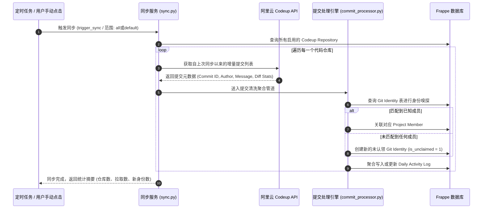
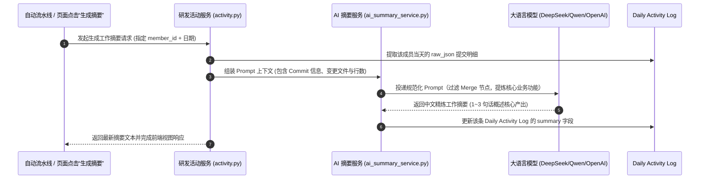
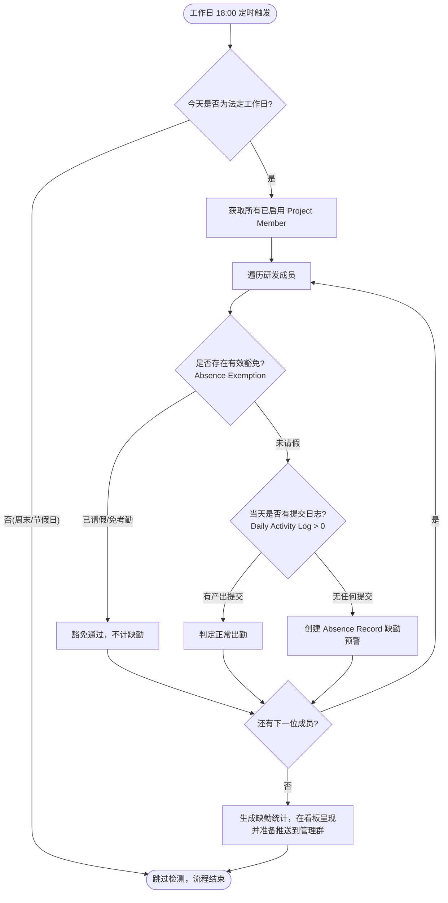
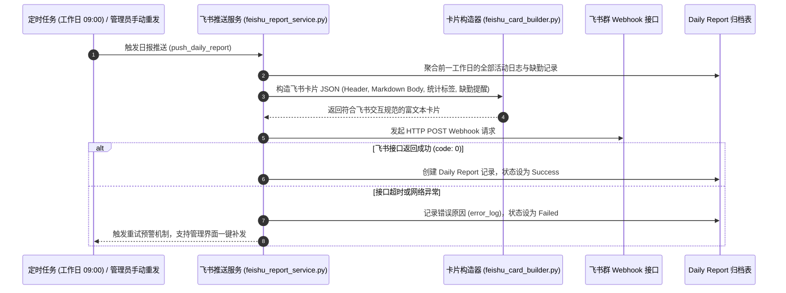
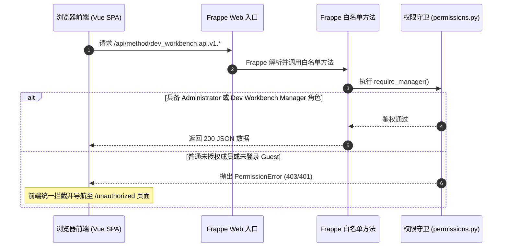

# 研发工作台 (Dev Workbench) 功能架构与业务流程拆解

> **版本**：v1.0.0 (生产就绪)  
> **底层框架**：Frappe Framework v16 + Vue 3 SPA + Frappe UI Charts (ECharts)  
> **集成体系**：阿里云云效 (Codeup API) + 大模型 (LLM AI Summary) + 飞书群机器人 (Webhook Card)

---

## 目录
1. [系统定位与核心价值](#1-系统定位与核心价值)
2. [总体系统架构与技术栈](#2-总体系统架构与技术栈)
3. [核心数据模型 (DocTypes) 设计](#3-核心数据模型-doctypes-设计)
4. [六大核心业务流程拆解](#4-六大核心业务流程拆解)
   - [4.1 Codeup 代码提交增量拉取与身份匹配流](#41-codeup-代码提交增量拉取与身份匹配流)
   - [4.2 每日研发活动聚合与 AI 工作摘要生成流](#42-每日研发活动聚合与-ai-工作摘要生成流)
   - [4.3 研发考勤与请假豁免自动化流](#43-研发考勤与请假豁免自动化流)
   - [4.4 过去 12 周项目活跃度趋势度量流](#44-过去-12-周项目活跃度趋势度量流)
   - [4.5 飞书日报富文本卡片自动化推送流](#45-飞书日报富文本卡片自动化推送流)
   - [4.6 研发看板 SPA 路由、中间件与安全鉴权流](#46-研发看板-spa-路由中间件与安全鉴权流)
5. [API 接口清单与路由映射规范](#5-api-接口清单与路由映射规范)
6. [定时任务 (Scheduler Events) 调度清单](#6-定时任务-scheduler-events-调度清单)
7. [研发看板 (Vue SPA) 页面功能矩阵](#7-研发看板-vue-spa-页面功能矩阵)

---

## 1. 系统定位与核心价值

**研发工作台 (Dev Workbench)** 是一个面向现代软件工程团队的全链路研发效能度量与自动化协同平台。

传统研发管理中普遍存在**“代码提交散落、成员 Git 身份混乱、日报填写繁重且失真、考勤与产出脱节、团队长期产出趋势不可见”**等痛点。研发工作台通过打通底层代码仓库与上层协同办公工具，实现：
- **零人工侵入**：开发者正常 `git push`，系统自动监听、同步、去重、核算增减行与修改文件数；
- **智能身份闭环**：支持单个成员绑定多个 Git 提交邮箱/用户名，对新人与外部提交提供未归属认领闭环；
- **AI 赋能总结**：基于大语言模型自动提炼真实工作内容，剔除 Merge 杂音与无意义注释，自动生成结构化日报；
- **缺勤自动排查**：法定工作日下班后自动比对产出与请假免考勤记录，自动预警异常人员；
- **飞书卡片直达**：每日自动生成图文并茂的飞书富文本互动卡片，推送至研发主管与大群；
- **决策级看板**：基于 Frappe UI 规范自研 SPA 看板，支持横向项目对比、个人聚焦、分支隔离以及 12 周活跃度趋势分析。

---

## 2. 总体系统架构与技术栈

```mermaid
flowchart TB
    subgraph 上游数据源
        Codeup["阿里云云效 Codeup<br/>(Git Repositories)"]
    end

    subgraph 核心应用层 [Frappe App: dev_workbench]
        direction TB
        subgraph 后台定时调度
            CronSync["定时同步任务<br/>(每30分钟 / 实时触发)"]
            CronAbsence["缺勤检测任务<br/>(工作日 18:00)"]
            CronReport["飞书推送任务<br/>(工作日 09:00)"]
        end

        subgraph 核心服务引擎 [Services Engine]
            CodeupClient["Codeup 客户端 (codeup_client.py)"]
            CommitProc["提交清洗聚合 (commit_processor.py)"]
            AIClient["大模型总结 (ai_summary_service.py)"]
            AbsenceSvc["考勤与豁免引擎 (absence_service.py)"]
            TrendSvc["12周趋势引擎 (trend_service.py)"]
            FeishuSvc["飞书卡片构建 (feishu_report_service.py)"]
        end

        subgraph 数据底座 [MariaDB / DocTypes]
            D_Project["Project (业务项目)"]
            D_Repo["Codeup Repository (代码仓库)"]
            D_Member["Project Member (成员档案)"]
            D_Identity["Git Identity (提交者凭证)"]
            D_Activity["Daily Activity Log (每日日志)"]
            D_Absence["Absence Record (缺勤记录)"]
            D_Exemption["Absence Exemption (请假豁免)"]
            D_Report["Daily Report (日报归档)"]
            D_Settings["Dev Workbench Settings (系统配置)"]
        end

        subgraph 通信与权限
            MethodAPI["Frappe Method / Resource API"]
            PermAuth["统一管理者权限守卫<br/>(permissions.py)"]
        end
    end

    subgraph 前端交互看板 [Vue 3 SPA]
        Router["Vue Router (SPA History)"]
        Tab1["成员日报明细"]
        Tab2["缺勤提醒处理"]
        Tab3["项目活跃度趋势 (LineChart)"]
        Tab4["日报归档历史"]
        Config["配置中心 (项目/成员/仓库/豁免)"]
    end

    subgraph 下游协同端
        Feishu["飞书开放平台 Webhook<br/>(互动富文本卡片)"]
        BrowserUser["研发管理者 / 团队工程师<br/>(PC 浏览器)"]
    end

    Codeup --> CodeupClient
    CronSync --> CodeupClient
    CodeupClient --> CommitProc --> D_Activity
    D_Identity <--> CommitProc
    D_Activity --> AIClient --> D_Activity
    CronAbsence --> AbsenceSvc --> D_Absence
    D_Exemption --> AbsenceSvc
    CronReport --> FeishuSvc --> Feishu
    D_Activity --> TrendSvc

	MethodAPI --> PermAuth
    PermAuth --> TrendSvc & AbsenceSvc & FeishuSvc
    Router --> Tab1 & Tab2 & Tab3 & Tab4 & Config
    BrowserUser --> Router
```



### 核心技术栈
- **后端平台**：Python 3.14 / Frappe Framework v16
- **前端架构**：Vue 3 + Vue Router (HTML5 History 模式) + Vite
- **图表体系**：遵循 Frappe UI Charts 规范自研 ECharts 封装（平滑曲线、对比虚线、参考线、交互图例）
- **样式体系**：Vanilla CSS 配合 Frappe CSS Variables，杜绝样式污染，自适应浅色与现代高质感排版
- **集成协议**：Aliyun Codeup OpenAPI (v40/v3), OpenAI 兼容规范 (DeepSeek/Qwen/GPT), 飞书自定义机器人 Webhook

---

## 3. 核心数据模型 (DocTypes) 设计

系统共定义了 11 个关键 DocType，分为以下 5 个逻辑层级：

| 逻辑分层 | DocType 名称 | 数据库物理表 | 核心职能描述 |
| :--- | :--- | :--- | :--- |
| **系统配置** | `Dev Workbench Settings` | `tabDev Workbench Settings` | 单例文档，存储 Codeup 凭证、AI 模型 API Key、提示词模版、飞书 Webhook 等全局配置。 |
| **组织与项目** | `Project` | `tabProject` | 业务研发项目主档，包含项目名称、部门、是否启用 (`is_active`) 等属性。 |
| | `Codeup Repository` | `tabCodeup Repository` | 云效代码仓库主档，记录仓库 ID、默认分支、分支统计范围、所属项目关联。 |
| | `Project Repository Item` | `tabProject Repository Item` | 项目挂载代码库的子表，支持一个业务项目聚合多个微服务或子库。 |
| **成员与身份** | `Project Member` | `tabProject Member` | 研发成员主档，记录姓名、邮箱、部门、工号、管理者标记 (`is_manager`)、在职启用状态 (`is_active`)。 |
| | `Git Identity` | `tabGit Identity` | Git 提交凭证表，记录 `author_name` 与 `author_email`，与成员建立多对一归属关联。 |
| | `Project Member Git Identity`| `tabProject Member Git Identity`| 成员关联身份的子表，展示与维护个人所拥有的 Git 别名。 |
| **研发活动核算** | `Daily Activity Log` | `tabDaily Activity Log` | 研发活动主核算表，基于 `[成员+项目+日期+分支范围]` 唯一索引。存储提交数、增行、删行、总行、影响文件数、AI 摘要、原始 Commits JSON。 |
| **考勤与豁免** | `Absence Record` | `tabAbsence Record` | 每日缺勤异常流水表，记录成员缺勤日期、状态（缺勤/已豁免/已补交）。 |
| | `Absence Exemption` | `tabAbsence Exemption` | 缺勤豁免表，记录请假日期区间、豁免原因，具有全局前置过滤效力。 |
| **报表与归档** | `Daily Report` | `tabDaily Report` | 每日汇总报表归档，记录推送状态 (Success/Failed)、飞书卡片原始内容、重试日志。 |

---

## 4. 六大核心业务流程拆解

### 4.1 Codeup 代码提交增量拉取与身份匹配流



**关键机制**：
- **分支范围隔离**：支持 `all`（全部分支）与 `default`（仅默认主干）双模式切换，在拉取时分别归集，避免功能分支污染主干统计；
- **智能增量游标**：记录最后同步时间戳，避免全量重拉带来的 API 限流；
- **未认领机制**：对未绑定员工的提交不会粗暴丢弃，而是统一归并至 `未归属提交`，并在前端看板置顶黄色警告横条，引导管理员一键认领。

---

### 4.2 每日研发活动聚合与 AI 工作摘要生成流



---

### 4.3 研发考勤与请假豁免自动化流



**看板快速标记豁免流**：
当管理员在看板“缺勤提醒”页面发现某成员因公外出或系统请假未同步时，可点击**【标记请假】**，调用 `dev_workbench.api.v1.absence.grant_exemption`。系统会自动创建一条 `Absence Exemption`，并**原子级将当天的 `Absence Record` 标记为已豁免并从缺勤列表中移除**。

---

### 4.4 过去 12 周项目活跃度趋势度量流

```mermaid
flowchart LR
    A[选定基准日期: 今日] --> B[滑动窗口划分: 计算过去12周周一与周日区间]
    B --> C[查询区间内全量 Daily Activity Log]
    C --> D[过滤已停用项目: 剔除 is_active = 0]
    D --> E[按周进行数据归并]
    
    E --> F1[计算项目各周提交次数 commits]
    E --> F2[计算项目各周代码变更行数 lines]
    E --> F3[统计各周活跃开发人数 active_members]
    E --> F4[计算全队周累计对比虚线 Total Series]
    
    F1 & F2 & F3 & F4 --> G[活跃动能分析: 比较近3周 vs 前3周]
    G --> H1[> +10%: 持续加速 ↗ (up)]
    G --> H2[< -10%: 放缓下行 ↘ (down)]
    G --> H3[区间内: 平稳推进 → (stable)]
    
    H1 & H2 & H3 --> I[输出 Frappe UI LineChart 契约结构]
```

**图表特性遵循规范**：
- **全队总计对比线**：`dashed: true` 虚线高亮显示；
- **周均基准线**：`referenceLines` 在 Y 轴动态打出目标参考基准；
- **丰富的 Tooltip**：悬浮展示当周提交次数、代码增删行与影响规模；
- **图例动态过滤**：点击底部图例交互式隐藏/显示特定项目系列。

---

### 4.5 飞书日报富文本卡片自动化推送流



---

### 4.6 研发看板 SPA 路由与安全鉴权流



---

## 5. API 接口与调用规范

系统不拦截 Frappe 全局请求。业务动作使用 Frappe 标准 Method API，普通 DocType
读取使用 Resource API，并由 DocType 权限与 `permissions.py` 共同限制访问。

| Method API | HTTP 方法 | 功能说明 | 权限要求 |
| :--- | :--- | :--- | :--- |
| `dev_workbench.api.v1.sync.trigger_sync` | POST | 手动立即触发 Codeup 提交拉取 | 管理者 |
| `dev_workbench.api.v1.activity.get_daily_overview` | GET | 获取全员活动看板概览 | 管理者 |
| `dev_workbench.api.v1.activity.get_project_trend` | GET | 获取项目与团队活跃度趋势 | 管理者 |
| `dev_workbench.api.v1.absence.get_absence_list` | GET | 获取指定日期缺勤数据 | 管理者 |
| `dev_workbench.api.v1.members.claim_git_identity` | POST | 认领并绑定 Git 身份 | 管理者 |
| `dev_workbench.api.v1.reports.resend_report` | POST | 重新推送日报 | 管理者 |
| `dev_workbench.api.v1.settings.get_codeup_repositories` | GET | 返回不含明文令牌的仓库配置 | 管理者 |

---

## 6. 定时任务 (Scheduler Events) 调度清单

注册在 `hooks.py` 中的自动化任务调度方案如下：

```python
scheduler_events = {
	"cron": {
		# 1. 代码提交同步：每 30 分钟拉取一次全部启用仓库增量
		"*/30 * * * *": [
			"dev_workbench.tasks.sync.sync_codeup_data",
		],
		# 2. 考勤自动化预警：工作日每天 18:00 执行缺勤检测
		"0 18 * * 1-5": [
			"dev_workbench.tasks.absence.check_absence",
		],
		# 3. 飞书日报推送：工作日每天 09:00 推送前一工作日总结卡片
		"0 9 * * 1-5": [
			"dev_workbench.tasks.report.push_daily_report",
		],
	},
}
```

---

## 7. 研发看板 (Vue SPA) 页面功能矩阵

前端基于 Vue 3 + Frappe UI 规范自研打造，位于 `/dev-workbench` 路由空间下：

```
/dev-workbench/dashboard
 ├── daily-activity   [成员日报] (多日区间选择、按项目/成员筛选、AI摘要重新生成、未认领横条提示)
 ├── absence-activity [缺勤提醒] (当日缺勤列表、所属项目与部门、一键“标记请假”实时豁免)
 ├── project-trend    [项目活跃度] (12周累计提交、周均产出、近3周总量、动能走向、平滑折线图、明细表)
 └── report-archive   [日报归档] (历史推送记录、飞书卡片可视化预览、重试发送按钮、发送回执状态)
/dev-workbench/projects     [项目配置] (业务项目增删改查、启用/停用状态流转、微服务仓库绑定)
/dev-workbench/members      [成员配置] (成员主档维护、Git 别名绑定、认领未分配凭证)
/dev-workbench/repositories [仓库配置] (Codeup 代码库发现、默认分支设定、分支统计范围设定)
/dev-workbench/exemptions   [请假豁免] (全局免考勤区间登记、请假原因追溯)
/dev-workbench/unauthorized [权限提示] (非管理者友好拦截，引导联系系统管理员)
```

---

*文档生成日期: 2026-10-15*  
*研发工作台项目团队保留所有权利。*
